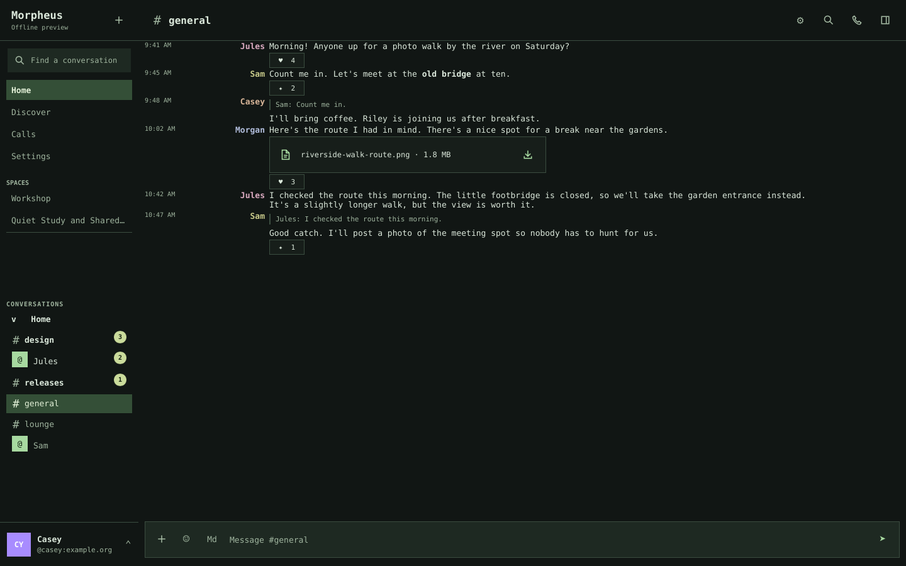
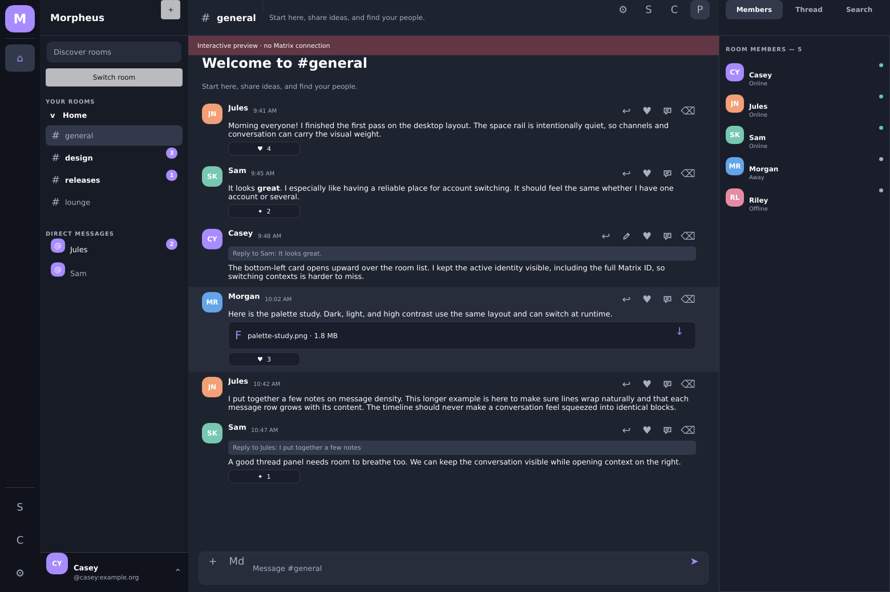
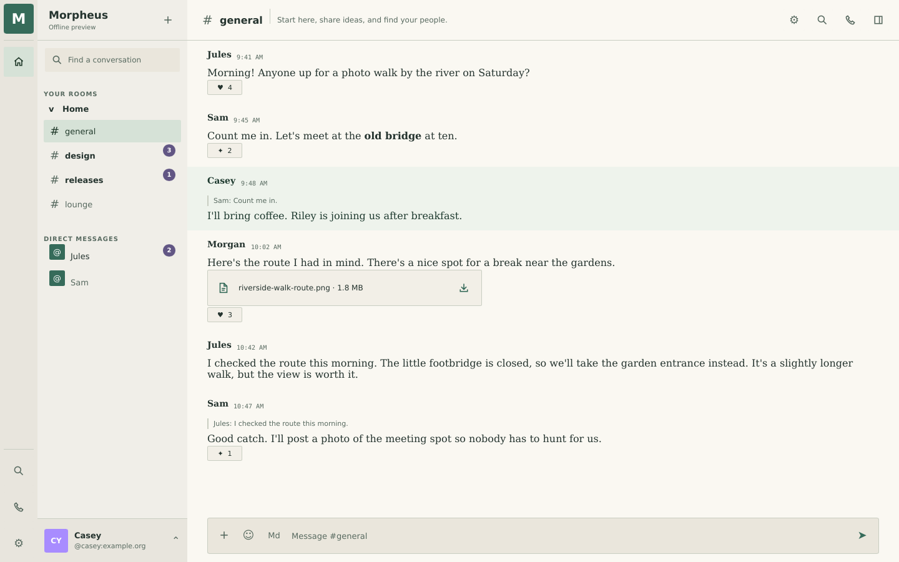

# Morpheus

A native Matrix client for **macOS, Linux and Windows**, built in Rust.
Multiple accounts, encrypted conversations and an interface you can make your own.

[Customization](docs/CUSTOMIZATION.md) · [Screenshots](docs/screenshots/README.md) · [Documentation](docs/README.md)

[](docs/screenshots/terminal-sidebar.png)

*Terminal preset. A real native capture with fictional accounts.*

**Pre-alpha:** source builds are available. Installer releases are pending
[release checks](docs/RELEASE_CHECKLIST.md). See [current status](docs/FEATURE_MATRIX.md)
for implemented features and remaining work.

## Make it yours

Start with **Nocturne**, **Terminal**, **Paper** or **Contrast**, then change the details:

- **Typography** — separate fonts for the interface, messages and code.
- **Messages** — stacked, compact or nickname-column layouts; avatars, timestamps and spacing.
- **Navigation** — icon rail or text sidebar; grouped or combined conversations and room ordering.
- **Appearance** — hex colors, window transparency, density, pane sizes, headers and corner radius.

Settings and `config.toml` control the same preferences. Changes reload live;
invalid edits keep the last working configuration and show the error. Search Settings
by a control name or TOML key to jump directly to its editor.

<details>
<summary>More looks: Nocturne and Paper</summary>

| Nocturne | Paper |
| --- | --- |
| [](docs/screenshots/desktop.png) | [](docs/screenshots/paper.png) |

</details>

[Customization guide](docs/CUSTOMIZATION.md) · [Theme files](themes/README.md)

## Conversations and accounts

- DMs, rooms and Spaces; threads, replies, edits, reactions and attachments.
- Per-conversation drafts and an account-scoped encrypted local search index.
- Bottom-left account switching, with separate sessions, encryption stores, drafts and credential-vault entries. Inactive accounts pause by default.
- One optional local app password for protected switching and startup restore; direct removal from **Manage accounts**.

Native voice, video and screen sharing are experimental and require compatible
MatrixRTC services. [Feature status](docs/FEATURE_MATRIX.md) · [Account controls](docs/ACCOUNT_ACCESS.md)

## Build from source

Install the [native dependencies](docs/PACKAGING.md) and pinned Rust toolchain:

```sh
cargo run --locked -p morpheus-app
```

Sign in with a Matrix account or explore the offline preview. See the
[packaging guide](docs/PACKAGING.md) for native-call build options.

## Contribute

Read the [contribution guide](CONTRIBUTING.md) and [build policy](AGENTS.md).
[Report bugs](https://github.com/brk275/Morpheus/issues) or
[report security vulnerabilities privately](SECURITY.md).

## License

[AGPL-3.0-or-later](LICENSE). See [third-party notices](vendor/README.md)
for dependency licenses and provenance. Required framework attribution is included in About.
