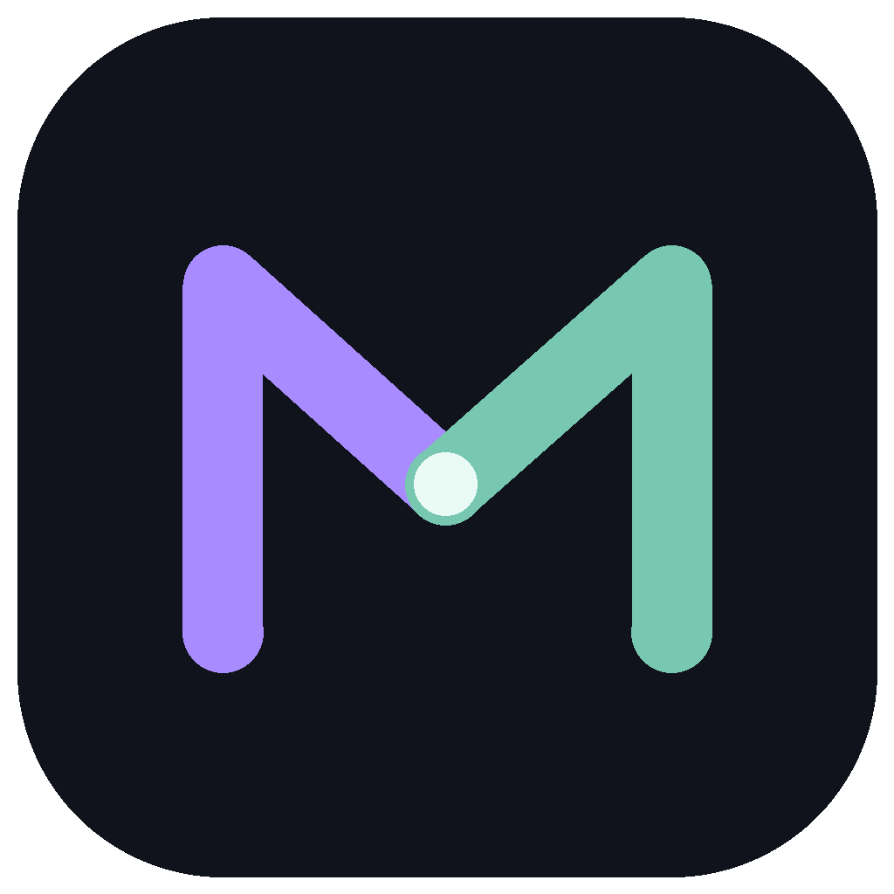

<p align="center">
  
</p>

<h1 align="center">Morpheus</h1>

<p align="center">
  <strong>Native Matrix for macOS, Linux and Windows.</strong><br>
  Built in Rust. Multiple accounts. Live customization.
</p>

<p align="center">
  <a href="docs/CUSTOMIZATION.md">Customization</a> ·
  <a href="docs/screenshots/README.md">Gallery</a> ·
  <a href="docs/README.md">Documentation</a> ·
  <a href="CONTRIBUTING.md">Contributing</a>
</p>


<p align="center"><sub>Terminal preset · Real native capture · Fictional accounts</sub></p>

**Pre-alpha.** Source builds are available; installer releases are pending
[release checks](docs/RELEASE_CHECKLIST.md). [See current status →](docs/FEATURE_MATRIX.md)

## Shape your workspace

Start with **Nocturne**, **Terminal** or **Paper**. Change the fonts, colors,
message layout and geometry independently:

- Stacked, compact or nickname-column messages; optional avatars and timestamps.
- An icon rail or text sidebar; grouped or combined room and DM lists.
- Separate interface, message and code fonts; adjustable density and pane widths.
- TOML themes with semantic colors for senders, unread messages, links and focus.

Settings and `config.toml` edit the same preferences. Changes reload live.
Invalid edits show an error and keep the last working setup.

| Nocturne | Paper |
| --- | --- |
| [](docs/screenshots/desktop.png) | [](docs/screenshots/paper.png) |

[Customization guide](docs/CUSTOMIZATION.md) · [Theme files](themes/README.md) · [Full-size gallery](docs/screenshots/README.md)

## Multiple accounts

Keep separate Matrix aliases in one app and switch from the bottom-left profile
menu. Each account has its own session, encryption store, drafts and
credential-vault entry. Inactive accounts pause by default.

One optional local app password protects switching and startup restore.
Remove saved accounts directly from **Manage accounts**, with a retry if local
cleanup is incomplete. [Account controls →](docs/ACCOUNT_ACCESS.md)

## Conversations

DMs, rooms and Spaces, with threads, replies, edits, reactions, attachments and
per-conversation drafts. Search uses an account-scoped encrypted local index.
Native voice, video and screen sharing are experimental and require a compatible
MatrixRTC service. [Feature status and current limits →](docs/FEATURE_MATRIX.md)

## Build from source

Install the [native build dependencies](docs/PACKAGING.md) and pinned Rust toolchain:

```sh
cargo run --locked -p morpheus-app
```

Sign in with a Matrix account or explore the offline preview. Native-call build
options are documented in the [packaging guide](docs/PACKAGING.md).

## Contribute

[Contribution guide](CONTRIBUTING.md) · [Issues](https://github.com/brk275/Morpheus/issues) · [Build policy](AGENTS.md) · [Private security reports](SECURITY.md)

## License

[AGPL-3.0-or-later](LICENSE). Dependency licenses and provenance are recorded in
the [third-party notices](vendor/README.md). Required UI framework attribution
is included in About.
