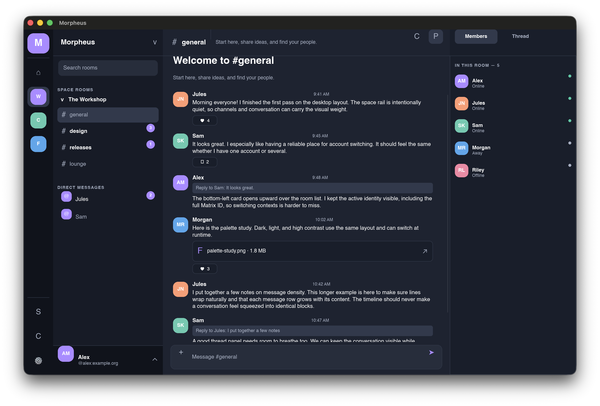

# Morpheus

Morpheus is an original, native Rust Matrix desktop client in development. The
interface is inspired by familiar community-chat navigation, with a distinct
design, deep configuration, and fast Matrix account switching.

**Status:** pre-alpha. Password sign-in, browser Matrix SSO, account switching,
Spaces, basic room timelines, plain-text replies and edits, a reaction control,
text threads, and in-session room drafts are wired into the desktop app. An
opt-in native audio path exposes controls to open or join a MatrixRTC room call
on a compatible homeserver. Rich formatting and media, full call controls,
video, recovery screens, and platform acceptance tests remain in progress. Do
not rely on this client for important conversations or
encryption-key recovery yet. The first beta requires the cross-platform checks
in [the feature matrix](docs/FEATURE_MATRIX.md).



## Direction

- Native Slint interface; no embedded browser views.
- Matrix Rust SDK for chat, room state, and encryption.
- Separate persistent data and encryption keys for each account.
- Native MatrixRTC/LiveKit calls where the homeserver supports them.
- In-app settings and a reloadable TOML configuration.
- macOS, Linux, and Windows releases after platform testing.

The source is original. Cinny, Discord, and Halloy are design and product
references, and their code, artwork, names, and icons are not included.

## Development

Install the toolchain in `rust-toolchain.toml`, then run:

```sh
cargo fmt --all -- --check
cargo test --locked -p morpheus-config -p morpheus-matrix -p morpheus-rtc
cargo run -p morpheus-app
cargo check --locked -p morpheus-app --features native-calls
cargo run -p morpheus-app --features native-calls
```

The app opens on Matrix sign-in and includes an explicitly labeled interactive
offline preview. A preview conversation does not send network messages or join
a call. Browser sign-in uses the Matrix SSO login-token flow; MSC3861 OIDC is
not implemented yet. The default build has a labeled call preview; the
`native-calls` feature enables experimental microphone audio on homeservers
that provide a compatible MatrixRTC/LiveKit service. Calls require the SDK's
sticky sliding-sync path. In-session drafts are discarded when the app exits.
See [architecture](docs/ARCHITECTURE.md) for the intended boundaries.

The package configuration is in [Packager.toml](Packager.toml). Install
`cargo-packager` to build a local installer with `cargo packager --release`.
Private preview packages are not signed or offered as public downloads.

## License

Morpheus is licensed under AGPL-3.0-or-later. See [LICENSE](LICENSE). The
application's About panel includes Slint's required attribution widget.
