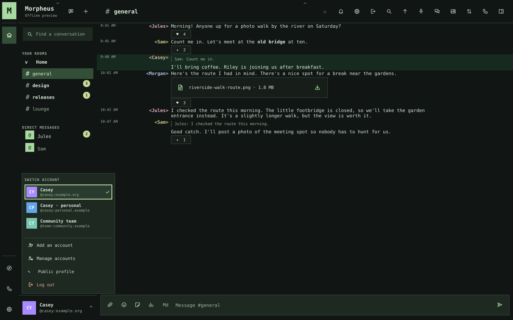
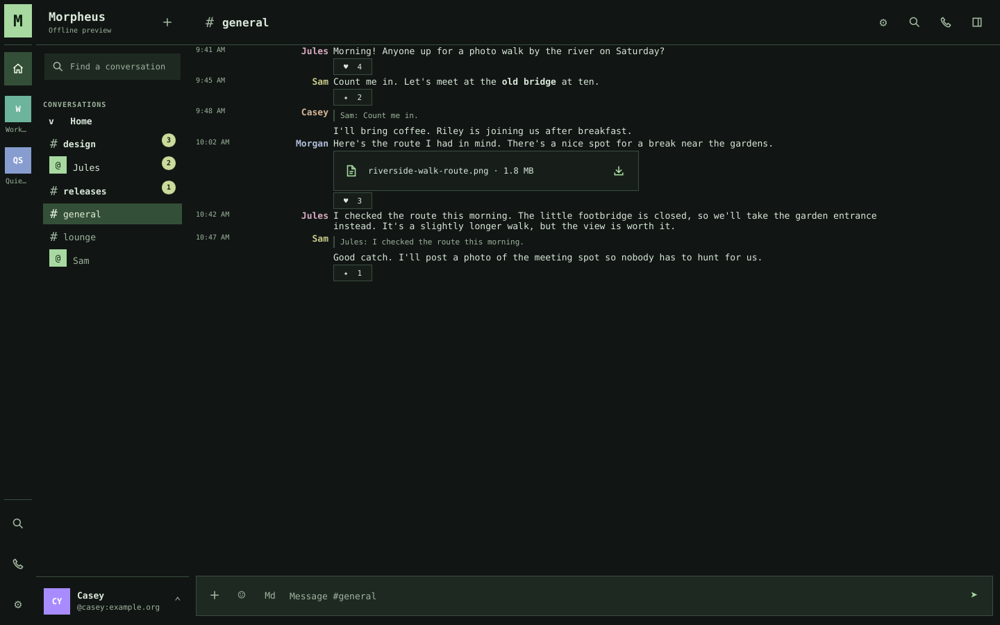
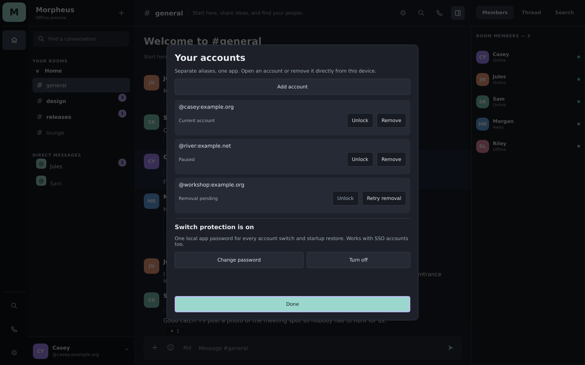
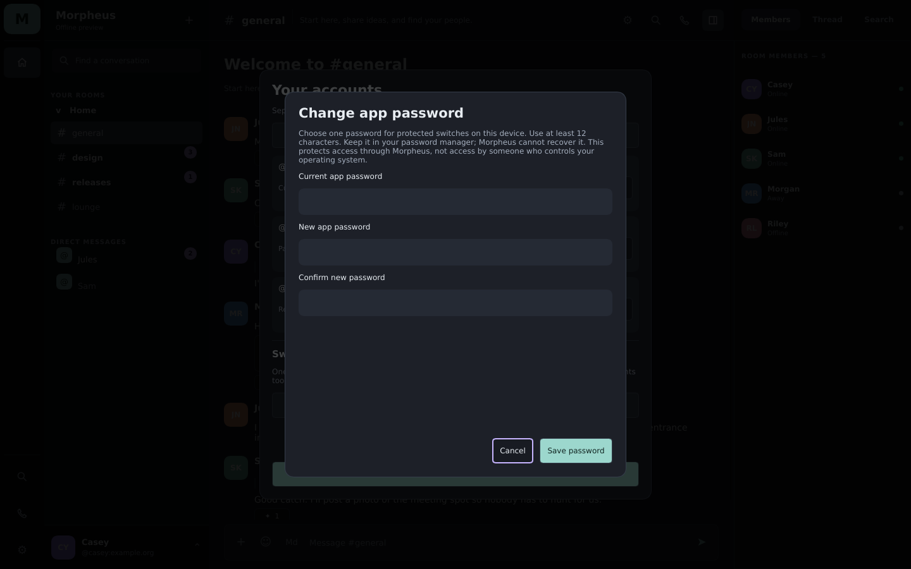
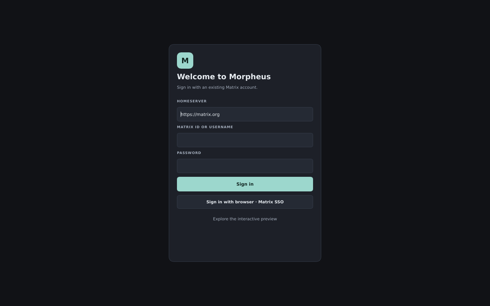

# Native screenshots

Real native captures with fictional offline accounts. Each image is a
1440 × 900 lossless PNG. These show the interface; Morpheus remains pre-alpha.

## Terminal and account switching

Monospaced messages, aligned nickname columns, square controls, no message
avatars and a minimal room header. The upward account menu keeps separate
aliases close at hand.

## Sidebar and labeled rail

Optional text navigation, a combined room/DM list and unread-first ordering:

The narrow icon rail can also show Space labels. Long names shorten visually;
controls retain the complete accessible name.

## Nocturne

Stacked messages, avatars, room context and the members panel.

## Paper

Serif message text, warm light surfaces, compact headers and no message avatars.

## Account controls

The account manager exposes direct removal and one optional local app password
for protected switches. The fixture includes a pending-removal row to show the
retry control. See [account access](../ACCOUNT_ACCESS.md) for behavior and limits.

## Sign-in

## Capture provenance

Source revision, capture run and image checksums

Captured on October 17, 2026, from the tested
[PR 9](https://github.com/brk275/Morpheus/pull/9) merge snapshot
`78f6f46d401d0dd091eedae1278c015c459760c9`, on the standard Ubuntu runner in
[CI run 39074067812](https://github.com/brk275/Morpheus/actions/runs/39074067812),
attempt 1. The pixels are unchanged and the files contain no embedded metadata.

The native capture command is `--morpheus-capture-preview`; CI converts its RGB
snapshots to PNG with `scripts/encode_preview_pngs.py`. The source artifact was
`native-preview-78f6f46d401d0dd091eedae1278c015c459760c9-1`, ID `12116672244`.
Its archive SHA-256 is
`e2cb955703f14afe8c82e4638918ed9087f32dc5338abda8d39eec548f86ce28`.
`desktop-preview.png` was copied here as `desktop.png`, and `paper-preview.png`
as `paper.png`. Every image was copied byte for byte after privacy and visual
review. All eight images below came from the same native executable, SHA-256
`828516c07b29468eff912666c41a8c1370854bb105e773875c9f84ecd7a33918`.

| File | SHA-256 |
| --- | --- |
| `desktop.png` | `e46322d8ba1ef3c285df62a7fb2f9cbd9a5c7ee7809b1d0f7797088f38ef4051` |
| `account-switcher.png` | `c131e5238c5323ae5a27180be943f6832c6837c559ba7a9ec06e44e0935b5a55` |
| `paper.png` | `14df8b7d3b9266633c08a83f36c31c6ca7431ab1aa22ff4d0d964e482ea5576e` |
| `manage-accounts.png` | `422081010f89253a4d97eaacf086e987da81ba26e89fdf005025fdd22044b305` |
| `account-password.png` | `7d4c7ac0fb304f82fd9ab80371d092b2ee6893472cbfc78bbcf083730b0b4a21` |
| `sign-in.png` | `efcf41e65b1ca636511c612f2fbb56a024ba9b1f32c1ef906766e10a9d6ef367` |
| `terminal-sidebar.png` | `113c69a3ef7fd607c884a6973424766969b706721098c424116ab4fb47770766` |
| `terminal-space-labels.png` | `4250c62a176e235b6877cc02d63bbe1ec93a9049a818527b2fac9b92a1af8781` |

